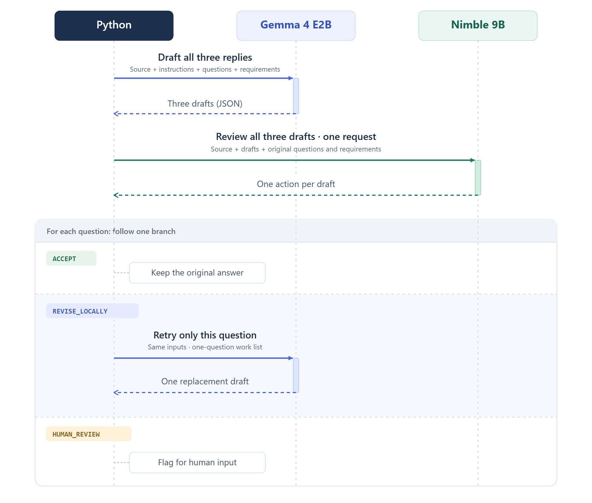
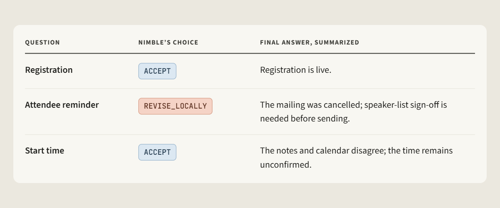

# Local LLM replies with a decision-model reviewer

A companion notebook for combining **Gemma 4 E2B** and **Nimble 9B**, both running locally through Ollama.

The notebook drafts answers to three workshop attendee questions, reviews them in one Nimble request, and retries only a question selected for `REVISE_LOCALLY`.

**[Open the notebook](selective_intervention.ipynb)** to follow the complete implementation and view its saved outputs.



## Run the notebook

Use Python 3.11 or later. Install and start [Ollama](https://ollama.com/download), then download the models:

```sh
ollama pull gemma4:e2b
ollama pull nimble:9b-q4_K_M
```

Install the dependencies in the Python environment you will use for the notebook:

```sh
python -m pip install -r requirements.txt
```

Open `selective_intervention.ipynb`, select that Python environment as the kernel, and run the cells in order. Keep Ollama running. The saved example used Ollama 0.40.14.

The defaults use `http://localhost:11434` and the model names above. To customize them, copy [.env.example](.env.example) to `.env` and edit its three settings.

## How it works

1. **Draft:** Gemma answers all three questions in one structured-output call. Each question includes its requirement.
2. **Review:** One native Nimble request reviews the actual drafts against the full conversation and their original requirements.
3. **Follow up:** Python keeps accepted answers, re-answers a selected question through the same Gemma helper, or flags a question for human input.

The initial generation and focused retry share the same prompt template, instructions, source, and model settings. The retry contains only the selected question and its unchanged requirement.

## Saved example

Gemma initially says the attendee reminder has been sent. Nimble selects `REVISE_LOCALLY`, and the focused retry returns the cancellation and pending sign-off condition.



The notebook contains the verbatim model outputs. The diagram's editable source is available as [SVG](figures/local_review_sequence.svg).
